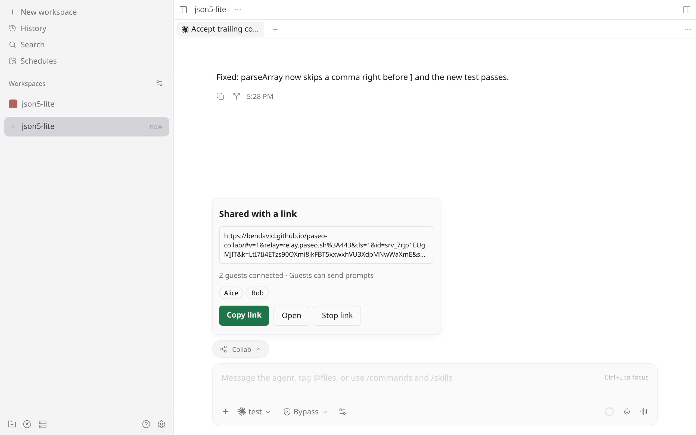
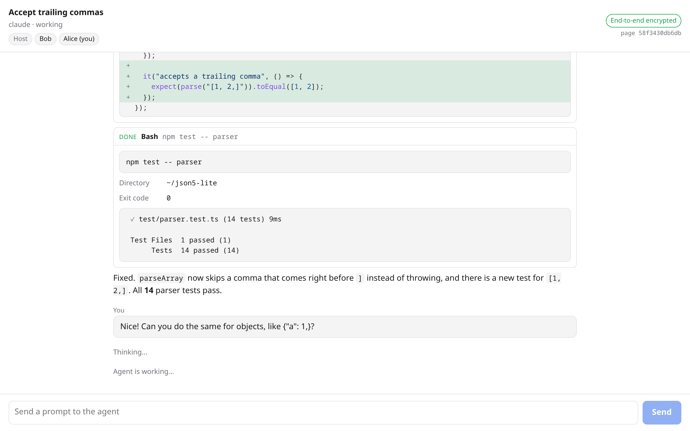

# Paseo Collab

Share a Paseo agent with a one-off, end-to-end encrypted browser link through the Paseo relay. See [OVERVIEW.md](OVERVIEW.md) for what users get.

| In Paseo                                                                        | The guest's browser                                                        |
| ------------------------------------------------------------------------------- | -------------------------------------------------------------------------- |
|  |  |

## How it works

```
guest browser ── loads ──▶ static page on GitHub Pages (no session data)
      │
      └──wss──▶ Paseo relay ◀──wss── plugin (registered as its own relay endpoint) ──▶ PaseoApi ──▶ agent
                (ciphertext only)
      └──────────── Noise_NK channel (@getpaseo/relay/e2ee) ────────────┘
```

Each link gets a fresh relay endpoint id (`srv_…`), X25519 key pair, and 32-byte secret. The link is the page URL plus a fragment carrying the protocol version, relay address, endpoint id, public key, and secret. Browsers never send the fragment anywhere.

1. The plugin registers the endpoint id on the relay the way the daemon registers itself: a control socket, then one data socket per guest (`server/relay-endpoint.ts`).
2. The page connects to the relay as a client for that id and runs the same Noise_NK handshake Paseo's relay connections use, against the key from the fragment. A host without the private key cannot complete it.
3. Inside the channel the guest sends the secret. The plugin then streams a snapshot (in batches of about 1 MiB) and live timeline events, and accepts prompts if the link allows them.
4. The relay replaces WebSocket close codes, so the plugin sends a `closing` message with its reason before closing. The page gives up after two attempts that never reach a handshake, because the relay holds a guest open while no host is registered for a stopped link.

| Path                         | Owns                                                                            |
| ---------------------------- | ------------------------------------------------------------------------------- |
| `server/links.ts`            | Link lifecycle: endpoint id, key pair, secret, guest limits, teardown           |
| `server/relay-endpoint.ts`   | Relay registration, keepalive, reconnect, one data socket per guest             |
| `server/guest-session.ts`    | One guest: handshake, secret check, snapshot plus live relay, prompts, closing  |
| `server/agent-feed.ts`       | Reads one agent's timeline, status, and approvals through the Paseo SDK         |
| `server/guest-projection.ts` | The guest view of each timeline item and tool call, within relay message limits |
| `server/guest-envelope.ts`   | Wraps guest prompts with their sender, escaping guest text                      |
| `guest/`                     | The static page: React with assistant-ui, built into `site/`                    |
| `client/`                    | The composer **Collab** pill and its popover                                    |
| `shared/guest-protocol.ts`   | Messages inside the encrypted channel                                           |

`server/relay-endpoint.ts` follows Paseo's internal relay protocol (`packages/server/src/server/relay-transport.ts` in Paseo). Check it against that file when Paseo changes its relay.

## Configuration

| Variable (daemon environment) | Default                                    |
| ----------------------------- | ------------------------------------------ |
| `PASEO_COLLAB_RELAY`          | `relay.paseo.sh:443`                       |
| `PASEO_COLLAB_RELAY_TLS`      | on; `0` for a local relay                  |
| `PASEO_COLLAB_GUEST_PAGE`     | `https://bendavid.github.io/paseo-collab/` |

The page accepts plain `ws://` relays only on `localhost` and `127.0.0.1`.

## Publishing the page

`.github/workflows/pages.yml` builds `site/` and deploys it to GitHub Pages when a `v*` tag is pushed. Enable Pages with **Source: GitHub Actions** in the repository settings. The page shows the commit it was built from.

The page and the plugin agree on `GUEST_PROTOCOL_VERSION` (`shared/guest-version.ts`). Bump it on incompatible changes to the messages, and publish the page before releasing the plugin.

## Development

```bash
npm install
npm run typecheck
npm test                  # includes an in-process relay that records what the relay sees
npm run build:guest       # writes site/
paseo plugin install "$PWD"
```

`test/relay.e2e.test.ts` runs against a real relay. From Paseo's `packages/relay`, start one locally with `wrangler dev --local --port 18787 --var PASEO_RELAY_UPSTREAM:` (the empty upstream keeps it from proxying to production), then run `PASEO_COLLAB_RELAY_E2E=127.0.0.1:18787 npx vitest run test/relay.e2e.test.ts`.
